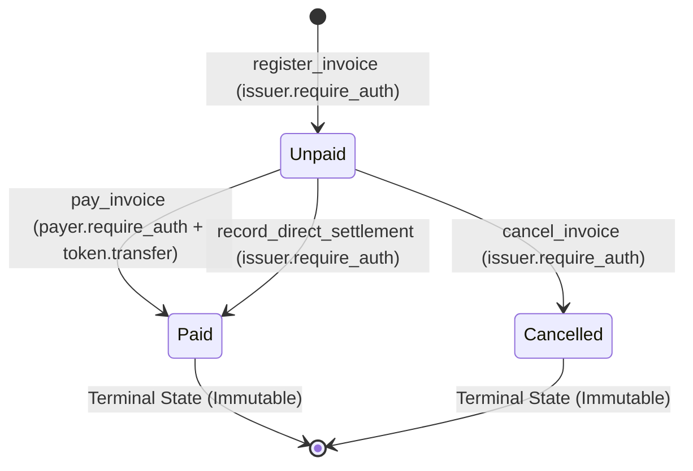

# Soroban Invoice Registry — Contract Specification & Integration Interface

**Repository:** `bill-generator-contracts`  
**Crate:** `invoice_registry`  
**Target Runtime:** Soroban Protocol 22 (`soroban-sdk = "22.0.0"`)  
**Cross-References:**  
- Backend API Specification: [`bill-generator-backend/openapi.yaml`](../../bill-generator-backend/openapi.yaml)
- Frontend Integration Specification: [`bill-generator-frontend/docs/INTEGRATION_SPEC.md`](../../bill-generator-frontend/docs/INTEGRATION_SPEC.md)
- Root Project Plan: [`PROJECT_PLAN.md`](../../PROJECT_PLAN.md)

---

## 1. Overview & Purpose

The `InvoiceRegistry` smart contract acts as the on-chain settlement agent and immutable proof-of-issuance anchor for the Stellar Bill Generator platform.

### Core Principles
1. **Zero Customer PII On-Chain:** Customer names, addresses, emails, line-item descriptions, and tax numbers are strictly prohibited from on-chain storage.
2. **Cryptographic Proof of Issuance:** Each invoice anchors a 32-byte SHA-256 digest of its canonical JSON representation (RFC 8785) at registration.
3. **Dual Settlement Support:**
   - **Soroban-Native Settlement (`pay_invoice`):** The contract acts as the atomic settlement coordinator, transferring SEP-41 tokens from payer to issuer and updating on-chain state to `Paid`.
   - **Direct Stellar L1 Reconciliation (`record_direct_settlement`):** For invoices paid via Stellar Classic L1 (XLM or classic trustline assets with invoice memo), the merchant/issuer commits the verified 32-byte transaction hash to reconcile the on-chain registry without double-charging tokens.
4. **Permanent Replay Protection:** Invoices cannot be re-registered, re-paid, or modified once terminal status is reached.

---

## 2. Canonical Data Models & Identifiers

### 2.1 Canonical Invoice Identifier (`invoice_id`)
To ensure zero collisions and mathematical reproducibility across the backend, frontend, and smart contract, the canonical on-chain `invoice_id` is defined as:

$$\text{invoice\_id} = \text{SHA-256}\left(\text{"stellar-invoice:"} \,+\, \text{merchant\_id\_uuid} \,+\, \text{":"} \,+\, \text{invoice\_number}\right)$$

- **Type in Rust:** `BytesN<32>`
- **Type in TypeScript / REST API:** 64-character lowercase hex string (prefixed with `0x` in JSON payloads, e.g. `0xa1b2c3...`).
- **Example:** For merchant `b6e12e3e-4b2a-4a5f-8c3b-123456789abc` and invoice `INV-2026-0001`, the input string is `stellar-invoice:b6e12e3e-4b2a-4a5f-8c3b-123456789abc:INV-2026-0001`. Its SHA-256 digest is the canonical 32-byte identifier.

### 2.2 Asset Representation
In Soroban, all assets are represented by an `Address`:
- **Native XLM:** Represented via the Stellar Asset Contract (SAC) address for native XLM (Testnet SAC: `CDLZFC3SYJYDZT7K67VZ75HPJVIEUVNIXF47ZG2FB2RMQQVU2HHGCYSC`).
- **Stellar Classic Issued Assets:** Represented by their deployed SAC address (`stellar contract asset deploy`).
- **Soroban SEP-41 Tokens:** Represented by the token contract's `Address` (starts with `C...`).

### 2.3 Amount Representation
- **Type in Rust:** `i128` (signed 128-bit integer, standard for Soroban token balances).
- **Scale:** Base minor token units according to the token's `decimals()` contract property (e.g. 7 decimals for XLM/SAC stroops, 6 decimals for standard USDC).
- Negative or zero amounts are rejected with `ContractError::InvalidAmount`.

### 2.4 State Model (`InvoiceStatus`)
```rust
#[contracttype]
#[derive(Clone, Copy, Debug, Eq, PartialEq)]
#[repr(u32)]
pub enum InvoiceStatus {
    Unpaid = 0,
    Paid = 1,
    Cancelled = 2,
}
```

### 2.5 Storage Data Structure (`InvoiceRecord`)
```rust
#[contracttype]
#[derive(Clone, Debug, Eq, PartialEq)]
pub struct InvoiceRecord {
    pub issuer: Address,         // Merchant Stellar Address
    pub amount: i128,            // Required payment amount in token minor units
    pub token: Address,          // Payment token contract address (SEP-41 / SAC)
    pub content_hash: BytesN<32>,// SHA-256 hash of RFC 8785 canonical invoice JSON
    pub status: InvoiceStatus,   // Current on-chain lifecycle state
    pub payment_ref: BytesN<32>, // 32-byte payment reference (tx hash or zeroes if unpaid)
    pub settled_at: u64,         // Ledger timestamp when marked Paid
}
```

### 2.6 Storage Keys & TTL Constants
```rust
#[contracttype]
#[derive(Clone)]
pub enum DataKey {
    Admin,
    Invoice(BytesN<32>),
}

// Storage lifecycle thresholds:
pub const LEDGER_THRESHOLD: u32 = 17_280;  // ~1 day (at 5 seconds per ledger)
pub const LEDGER_EXTEND_TO: u32 = 518_400; // ~30 days
```

---

## 3. Contract Interface Specification

```rust
#[contract]
pub struct InvoiceRegistry;

#[contractimpl]
impl InvoiceRegistry {
    /// Initialize contract admin. Callable exactly once.
    ///
    /// # Arguments
    /// * `admin` - The address granted administrative privileges.
    pub fn initialize(env: Env, admin: Address) -> Result<(), ContractError>;

    /// Register a new invoice commitment on-chain.
    ///
    /// # Requirements
    /// * `issuer.require_auth()` is enforced.
    /// * `amount > 0`.
    /// * `invoice_id` must not already exist in persistent storage.
    pub fn register_invoice(
        env: Env,
        issuer: Address,
        invoice_id: BytesN<32>,
        amount: i128,
        token: Address,
        content_hash: BytesN<32>,
    ) -> Result<(), ContractError>;

    /// Settle invoice on-chain using Soroban SEP-41 token transfer.
    ///
    /// # Requirements
    /// * `payer.require_auth()` is enforced.
    /// * `invoice_id` must exist and have status `InvoiceStatus::Unpaid`.
    /// * Transfers `amount` from `payer` to `invoice.issuer` via token client.
    /// * Transitions status to `InvoiceStatus::Paid`.
    /// * Records `payment_ref` (hash of invocation) and `settled_at` timestamp.
    pub fn pay_invoice(
        env: Env,
        payer: Address,
        invoice_id: BytesN<32>,
    ) -> Result<(), ContractError>;

    /// Settle invoice on-chain after verified direct Stellar L1 payment.
    ///
    /// # Requirements
    /// * `issuer.require_auth()` is enforced.
    /// * `invoice_id` must exist and have status `InvoiceStatus::Unpaid`.
    /// * Transitions status to `InvoiceStatus::Paid`.
    /// * Records `payment_ref` (the 32-byte Stellar L1 transaction hash) and `settled_at`.
    pub fn record_direct_settlement(
        env: Env,
        issuer: Address,
        invoice_id: BytesN<32>,
        payment_ref: BytesN<32>,
    ) -> Result<(), ContractError>;

    /// Cancel an unpaid invoice commitment.
    ///
    /// # Requirements
    /// * `issuer.require_auth()` is enforced.
    /// * `invoice_id` must exist and have status `InvoiceStatus::Unpaid`.
    /// * Transitions status to `InvoiceStatus::Cancelled`.
    pub fn cancel_invoice(
        env: Env,
        issuer: Address,
        invoice_id: BytesN<32>,
    ) -> Result<(), ContractError>;

    /// Query an invoice record.
    ///
    /// Extends persistent storage TTL on read.
    pub fn get_invoice(env: Env, invoice_id: BytesN<32>) -> Option<InvoiceRecord>;
}
```

---

## 4. Lifecycle State Transitions & Invariants



### Invariants
1. **Immutability of Terminal States:** Once `InvoiceRecord.status` is `Paid` or `Cancelled`, no further mutations are allowed. Subsequent calls to `pay_invoice`, `record_direct_settlement`, or `cancel_invoice` fail immediately with `ContractError::AlreadyPaid` or `ContractError::AlreadyCancelled`.
2. **Duplicate Protection:** Registering an existing `invoice_id` fails with `ContractError::InvoiceAlreadyExists`.
3. **Amount Protection:** In `pay_invoice`, the transferred token amount is strictly read from storage (`record.amount`), preventing any front-end price tampering.

---

## 5. Contract Errors & Event Specification

### 5.1 Error Codes (`ContractError`)
```rust
#[contracterror]
#[derive(Copy, Clone, Debug, Eq, PartialEq, PartialOrd, Ord)]
#[repr(u32)]
pub enum ContractError {
    AlreadyInitialized = 1,
    Unauthorized = 2,
    InvalidAmount = 3,
    InvoiceAlreadyExists = 4,
    InvoiceNotFound = 5,
    AlreadyPaid = 6,
    AlreadyCancelled = 7,
    TransferFailed = 8,
}
```

### 5.2 Emitted Events
All events are emitted using `env.events().publish(topics, data)`:

| Event Name | Topics | Data Payload | Trigger Condition |
| :--- | :--- | :--- | :--- |
| `register` | `(Symbol::new(&env, "register"), issuer: Address, invoice_id: BytesN<32>)` | `(amount: i128, token: Address, content_hash: BytesN<32>)` | Invoice registered. |
| `pay` | `(Symbol::new(&env, "pay"), invoice_id: BytesN<32>, payer: Address)` | `(amount: i128, settled_at: u64)` | Paid via Soroban token transfer. |
| `settle_direct` | `(Symbol::new(&env, "settle_direct"), invoice_id: BytesN<32>, issuer: Address)` | `(payment_ref: BytesN<32>, settled_at: u64)` | Reconciled after direct L1 payment. |
| `cancel` | `(Symbol::new(&env, "cancel"), invoice_id: BytesN<32>, issuer: Address)` | `()` | Invoice cancelled. |

---

## 6. How Backend & Off-Chain Systems Verify On-Chain State

The backend interacts with the smart contract via **Soroban RPC** (`@stellar/stellar-sdk` `rpc.Server`):

### 6.1 Verifying `pay_invoice` Transactions
1. Payer submits signed contract invocation and receives `transactionHash`.
2. Backend calls Soroban RPC:
   ```typescript
   const txResponse = await sorobanServer.getTransaction(transactionHash);
   ```
3. Backend validates:
   - `txResponse.status === 'SUCCESS'`
   - `txResponse.ledger > 0`
   - Scans contract events in `txResponse.resultMetaXdr` to verify the `pay` event topic contains the expected `invoice_id`.

### 6.2 Reading Registry State Directly
Backend or external auditor can query the contract's read-only function without submitting a transaction:
```typescript
const contract = new Contract(INVOICE_REGISTRY_CONTRACT_ID);
const op = contract.call('get_invoice', xdr.ScVal.scvBytes(invoiceIdBuffer));
const result = await sorobanServer.simulateTransaction(dummyTxWithOp);
// Parses ScVal into InvoiceRecord struct
```

---

## 7. TypeScript Client Bindings Strategy

To maintain strong cross-repository typing without circular dependencies:
1. `bill-generator-contracts` compiles the Wasm binary:
   ```bash
   stellar contract build
   ```
2. Generate TypeScript bindings using the official Stellar CLI:
   ```bash
   stellar contract bindings typescript \
     --wasm target/wasm32-unknown-unknown/release/invoice_registry.wasm \
     --id CA... \
     --output-dir packages/invoice-registry-client
   ```
3. The generated client package provides typed methods (`register_invoice`, `pay_invoice`, `get_invoice`) and ScVal conversions for use in `bill-generator-backend` and `bill-generator-frontend`.
